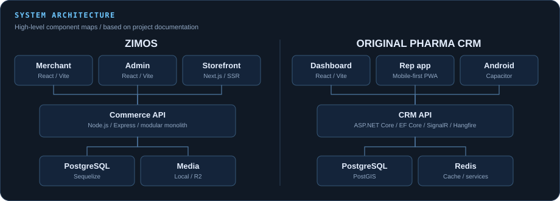
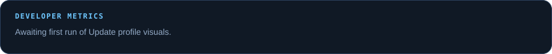
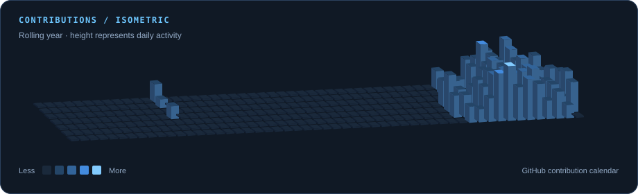
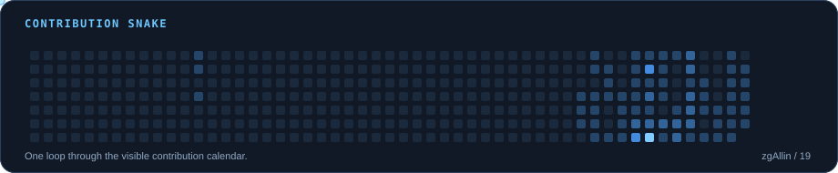

<!-- HEADER -->
<div align="center">


<p>
<a href="https://zimos.co"></a>&nbsp;
<a href="mailto:ziadabbas27@gmail.com"></a>&nbsp;
<a href="https://x.com/ziadabbas19"></a>&nbsp;
<a href="https://instagram.com/ziadabbas19"></a>&nbsp;
<a href="https://github.com/ziadabbas19"></a>
</p>

**FULL-STACK SOFTWARE DEVELOPER / FOUNDER / PRODUCT BUILDER**

<a href="https://zimos.co">zimos.co</a> · <a href="mailto:ziadabbas27@gmail.com">Get in touch</a>

</div>

## 01 / Identity

<table>
<tr>
<td width="70%" valign="middle">
<h3>Building software with purpose.</h3>
<p>I'm a full-stack software developer from Egypt and Founder of <a href="https://zimos.co"><b>Zimos</b></a>. I work across backend systems, application architecture, and digital product development.</p>
<p>My focus is turning complex business requirements into maintainable software and thoughtful user experiences.</p>
</td>
<td width="30%" align="center">

<br/><br/><b>FEDORA LINUX</b><br/><sub>DEVELOPMENT ENVIRONMENT</sub>
</td>
</tr>
</table>

## 02 / Technical Skills

<p align="center">
<a href="#02--technical-skills"></a><br/>
<a href="#02--technical-skills"></a>
</p>
<p align="center"><sub>SQL · PostGIS · EF Core · SignalR · Sequelize · Capacitor<br/>Podman · Railway · Cloudflare · JWT · Jest · Fedora</sub></p>

<details>
<summary><b>Engineering capabilities</b></summary>

| Domain | Focus |
|:---|:---|
| Architecture | Multi-tenant SaaS, modular monolith, monorepos |
| Backend | REST APIs, business logic, background jobs |
| Frontend | SSR, SPA, responsive UI, state management |
| Data | SQL, ORM, transactions, geospatial data |
| Security | Authentication, authorization, JWT, RBAC |
| Real-time | SignalR, GPS tracking, live updates |
| Mobile | Android, Capacitor, PWA |
| Infrastructure | Containers, deployment, edge caching |
| Testing | Unit, integration and API testing |

</details>

<p align="center"></p>

## 03 / Selected Work

<table>
<tr>
<td width="50%" valign="top">
<p align="center"><a href="https://zimos.co"></a></p>
<h2 align="center">ZIMOS</h2>
<p align="center"><sub>FOUNDER / SAAS / COMMERCE</sub></p>
<p align="center"></p>
<p>A multi-tenant platform for building websites, launching online stores and managing digital businesses.</p>
<ul><li>Merchant and platform dashboards</li><li>Website and storefront architecture</li><li>Commerce and business workflows</li></ul>
<p align="center"><a href="https://zimos.co"><b>LIVE PLATFORM</b></a><br/><a href="https://github.com/ziadabbas19/zimos-frontend">Frontend</a> · <a href="https://github.com/ziadabbas19/zimos">Backend</a></p>
</td>
<td width="50%" valign="top">
<p align="center"><a href="https://github.com/ziadabbas19/original-pharma-crm"></a></p>
<h2 align="center">ORIGINAL PHARMA</h2>
<p align="center"><sub>ENTERPRISE CRM / FIELD FORCE</sub></p>
<p align="center"></p>
<p>A CRM system designed for pharmaceutical field teams, supervisors and managers.</p>
<ul><li>Visit and field-force management</li><li>Geolocation and real-time workflows</li><li>Role-based access and mobile support</li></ul>
<p align="center"><a href="https://github.com/ziadabbas19/original-pharma-crm"><b>EXPLORE REPOSITORY</b></a></p>
</td>
</tr>
</table>
<p align="center"><a href="https://github.com/ziadabbas19?tab=repositories">Explore all repositories</a></p>

### Product Showcase

<p align="center"><a href="https://zimos.co"><b>Explore Zimos live</b></a> · <a href="https://github.com/ziadabbas19/zimos-frontend">Frontend</a> · <a href="https://github.com/ziadabbas19/original-pharma-crm">Explore the CRM</a></p>

<!-- Optional: add real, redacted product screenshots here. See INSTALL.md in the download. -->

## 04 / System Architecture

<p align="center"></p>

<p align="center"><sub>Architecture overview based on the project documentation, not a production topology audit.</sub></p>
<p align="center"><a href="https://github.com/ziadabbas19/zimos#architecture">Zimos backend design</a> · <a href="https://github.com/ziadabbas19/original-pharma-crm/blob/main/docs/architecture.md">CRM architecture</a></p>

<p align="center"></p>

## 05 / Engineering Focus

<table>
<tr>
<td width="33%" align="center"><h3>Systems</h3><sub>Architecture<br/>Modularity<br/>Scalability</sub></td>
<td width="33%" align="center"><h3>Engineering</h3><sub>Data integrity<br/>Backend systems<br/>Performance</sub></td>
<td width="33%" align="center"><h3>Product</h3><sub>SaaS platforms<br/>Digital commerce<br/>User experience</sub></td>
</tr>
</table>

**Currently building:** Zimos and enterprise software.  
**Exploring:** distributed systems, scalable architecture and better developer workflows.

## 06 / Currently Building & Exploring

| Building | Exploring |
|:---|:---|
| Zimos — SaaS and commerce platform | Scalable architectures and distributed systems |
| Enterprise applications and CRM | Backend performance and reliability |
| Product workflows and developer tooling | Better deployment and testing practices |

## 07 / Development Environment

<p align="center"></p>
<p align="center"><b>Fedora Linux · KDE Plasma · VS Code · Bash</b></p>

<details>
<summary><b>Background & languages</b></summary>

- Freelance full-stack development and small-team coordination.
- B.Sc. Science — Industrial Applied Chemistry, Tanta University.
- Arabic and English (B2–C1, self-assessed).

</details>

<p align="center"></p>

## 08 / Beyond the Code

```typescript
const zgAllin = {
    signature: 19,
    role: "Software Developer",
    venture: "Founder @ Zimos",
    environment: "Fedora Linux",
    interests: ["Engineering", "Architecture", "Entrepreneurship"],
    hobbies: ["Boxing", "Kickboxing", "Music", "Heavy Metal"],
    mindset: "Order through chaos."
};
```

<div align="center">

<table>
<tr>
<td width="25%" align="center"><br/><b>Boxing</b><br/><sub>Discipline</sub></td>
<td width="25%" align="center"><br/><b>Kickboxing</b><br/><sub>Precision</sub></td>
<td width="25%" align="center"><br/><b>Music</b><br/><sub>Expression</sub></td>
<td width="25%" align="center"><br/><b>Heavy Metal</b><br/><sub>Intensity</sub></td>
</tr>
</table>

</div>

<p align="center"></p>

## 09 / Developer Metrics

<p align="center"></p>

## 10 / Development Activity

<p align="center"><a href="https://github.com/ziadabbas19"></a></p>
<p align="center"><a href="https://github.com/ziadabbas19?tab=repositories">Repositories</a> · <a href="https://github.com/ziadabbas19">Contributions</a> · <a href="https://github.com/ziadabbas19?tab=followers">Followers</a></p>

## 11 / Contribution Visuals

<p align="center"></p>

<p align="center"></p>

<p align="center"><sub>Generated from GitHub-visible contribution data and refreshed daily by GitHub Actions.</sub></p>

<p align="center"></p>

## 12 / Establish Connection

<p align="center">
<a href="https://zimos.co"></a>&nbsp;
<a href="mailto:ziadabbas27@gmail.com"></a>&nbsp;
<a href="https://x.com/ziadabbas19"></a>&nbsp;
<a href="https://instagram.com/ziadabbas19"></a>&nbsp;
<a href="https://github.com/ziadabbas19"></a>
</p>

<div align="center">


<h2>zgAllin / 19</h2>

<a href="mailto:ziadabbas27@gmail.com">ziadabbas27@gmail.com</a> · <a href="https://zimos.co">zimos.co</a>

</div>
