<!-- ═══════════════════ HERO ═══════════════════ -->

<div align="center">



<br/>

<a href="mailto:ziadabbas27@gmail.com">

</a>
&nbsp;
<a href="https://x.com/ziadabbas19">

</a>
&nbsp;
<a href="https://instagram.com/ziadabbas19">

</a>
&nbsp;
<a href="https://github.com/ziadabbas19">

</a>

<br/><br/>

<a href="https://zimos.co"><b>Z I M O S . C O</b></a>

<br/><br/>


</div>

<!-- ═══════════════════ IDENTITY ═══════════════════ -->

## 01 — Identity

<table>
<tr>
<td width="68%" valign="middle">

<h3>Engineering meets entrepreneurship.</h3>

<p>
I'm a Full-Stack Software Developer and Founder of
<a href="https://zimos.co"><b>Zimos</b></a>.
</p>

<p>
My work revolves around software engineering, system architecture,
backend development, and building digital products that bridge
technology and business.
</p>

<p>
I build with purpose, challenge conventional thinking,
and turn complex ideas into practical solutions.
</p>

</td>
<td width="32%" align="center" valign="middle">


<br/><br/>

<b>FEDORA LINUX</b>

<br/>

<sub>DEVELOPMENT ENVIRONMENT</sub>

</td>
</tr>
</table>

<!-- ═══════════════════ TECHNOLOGIES ═══════════════════ -->

## 02 — Technical Skills

<p align="center">

<a href="#02--technical-skills">

</a>

<br/>

<a href="#02--technical-skills">

</a>

</p>

<p align="center">
<sub>
SQL · PostGIS · EF Core · SignalR · Sequelize · Capacitor
<br/>
Podman · Railway · Cloudflare · JWT · Jest · Fedora
</sub>
</p>

<br/>

<details>
<summary><b>Explore Engineering Expertise</b></summary>

<br/>

| Domain | Expertise |
|:---|:---|
| Software Architecture | Multi-Tenant SaaS, Modular Monolith, Monorepo |
| Backend Engineering | REST APIs, Business Logic, Background Jobs |
| Frontend Engineering | SSR, SPA, Responsive UI, State Management |
| Database Engineering | SQL, Data Modeling, ORM, Transactions |
| Security | Authentication, Authorization, JWT, RBAC |
| Real-Time Systems | SignalR, GPS Tracking, Live Updates |
| Mobile Development | Android, Capacitor, PWA |
| Infrastructure | Docker, Podman, Cloud Deployment |
| Testing | Unit Testing, Integration Testing, API Testing |
| Product Engineering | SaaS, E-Commerce, CRM, Enterprise Systems |

</details>

<!-- ═══════════════════ PROJECTS ═══════════════════ -->

## 03 — Selected Work

<table>
<tr>
<td width="50%" valign="top">

<h2 align="center">ZIMOS</h2>

<p align="center">
<sub>SAAS / COMMERCE / WEBSITE BUILDER</sub>
</p>

<p align="center">
<a href="https://zimos.co">

</a>
</p>

<p>
A multi-tenant commerce platform empowering businesses
to build websites, launch online stores, and manage
their digital presence.
</p>

<ul>
<li>Website and storefront builder</li>
<li>Merchant and platform dashboards</li>
<li>Multi-tenant architecture</li>
<li>Inventory and order management</li>
<li>Payment and business workflows</li>
<li>Custom domains and SEO</li>
</ul>

<p align="center">
<b>FOUNDER</b>
</p>

<p align="center">
<a href="https://zimos.co"><b>LIVE PLATFORM ↗</b></a>
<br/><br/>
<a href="https://github.com/ziadabbas19/zimos-frontend">Frontend</a>
&nbsp; / &nbsp;
<a href="https://github.com/ziadabbas19/zimos">Backend</a>
</p>

</td>
<td width="50%" valign="top">

<h2 align="center">ORIGINAL CRM</h2>

<p align="center">
<sub>ENTERPRISE / FIELD FORCE / GEOLOCATION</sub>
</p>

<p align="center">
<a href="https://github.com/ziadabbas19/original-pharma-crm">

</a>
</p>

<p>
An enterprise CRM platform designed to connect
pharmaceutical field teams, supervisors,
and managers through a centralized system.
</p>

<ul>
<li>Field-force and visit management</li>
<li>Organizational hierarchy</li>
<li>GPS and geospatial tracking</li>
<li>Role-based access control</li>
<li>Real-time activity monitoring</li>
<li>Web and Android applications</li>
</ul>

<p align="center">
<b>SOFTWARE DEVELOPMENT</b>
</p>

<p align="center">
<a href="https://github.com/ziadabbas19/original-pharma-crm">
<b>EXPLORE REPOSITORY ↗</b>
</a>
</p>

</td>
</tr>
</table>

<p align="center">
<a href="https://github.com/ziadabbas19?tab=repositories">
<sub>VIEW ALL REPOSITORIES ↗</sub>
</a>
</p>

<!-- ═══════════════════ ENGINEERING ═══════════════════ -->

## 04 — Engineering Philosophy

<table>
<tr>
<td width="33%" align="center" valign="top">

<h3>Architecture</h3>

<sub>
Scalable systems
<br/>
Modular design
<br/>
Maintainable structure
</sub>

</td>
<td width="33%" align="center" valign="top">

<h3>Engineering</h3>

<sub>
Backend systems
<br/>
Data integrity
<br/>
Performance
</sub>

</td>
<td width="33%" align="center" valign="top">

<h3>Product</h3>

<sub>
Digital experiences
<br/>
Business solutions
<br/>
Meaningful innovation
</sub>

</td>
</tr>
</table>

<!-- ═══════════════════ PERSONALITY ═══════════════════ -->

## 05 — Beyond the Code

```typescript
const zgAllin = {
    signature: 19,
    identity: "Ziad Abbas",
    role: "Software Developer",
    venture: "Founder @ Zimos",

    environment: {
        os: "Fedora Linux",
        editor: "VS Code"
    },

    interests: [
        "Software Engineering",
        "System Architecture",
        "Entrepreneurship"
    ],

    hobbies: [
        "Boxing",
        "Kickboxing",
        "Music",
        "Heavy Metal"
    ],

    philosophy: "Order through chaos."
};
```

<div align="center">

<table>
<tr>
<td width="25%" align="center">
<b>BOXING</b>
<br/>
<sub>Discipline</sub>
</td>
<td width="25%" align="center">
<b>KICKBOXING</b>
<br/>
<sub>Precision</sub>
</td>
<td width="25%" align="center">
<b>MUSIC</b>
<br/>
<sub>Expression</sub>
</td>
<td width="25%" align="center">
<b>HEAVY METAL</b>
<br/>
<sub>Intensity</sub>
</td>
</tr>
</table>

</div>

<!-- ═══════════════════ ACTIVITY ═══════════════════ -->

## 06 — Development Activity

<p align="center">

<a href="https://github.com/ziadabbas19">

</a>

</p>

<p align="center">
<a href="https://github.com/ziadabbas19?tab=repositories">Repositories</a>
&nbsp; / &nbsp;
<a href="https://github.com/ziadabbas19?tab=overview">Contributions</a>
&nbsp; / &nbsp;
<a href="https://github.com/ziadabbas19?tab=followers">Followers</a>
</p>

<!-- ═══════════════════ CONTACT ═══════════════════ -->

## 07 — Establish Connection

<div align="center">

<a href="mailto:ziadabbas27@gmail.com">

</a>
&nbsp;&nbsp;
<a href="https://x.com/ziadabbas19">

</a>
&nbsp;&nbsp;
<a href="https://instagram.com/ziadabbas19">

</a>
&nbsp;&nbsp;
<a href="https://github.com/ziadabbas19">

</a>

<br/><br/>

<a href="mailto:ziadabbas27@gmail.com">
<sub>ziadabbas27@gmail.com</sub>
</a>

<br/>

<a href="https://zimos.co">
<sub>ZIMOS.CO</sub>
</a>

</div>

<!-- ═══════════════════ SIGNATURE ═══════════════════ -->

---

<div align="center">


<br/>

<h2>zgAllin / 19</h2>

<sub>ENGINEER WITH INTENT.</sub>

<br/><br/>


</div>
